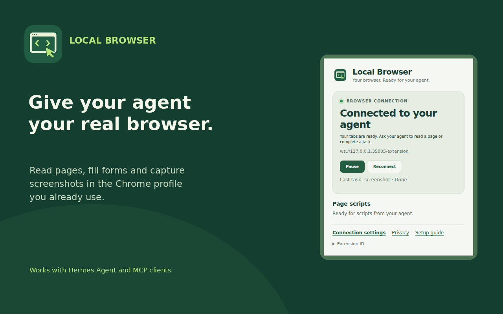
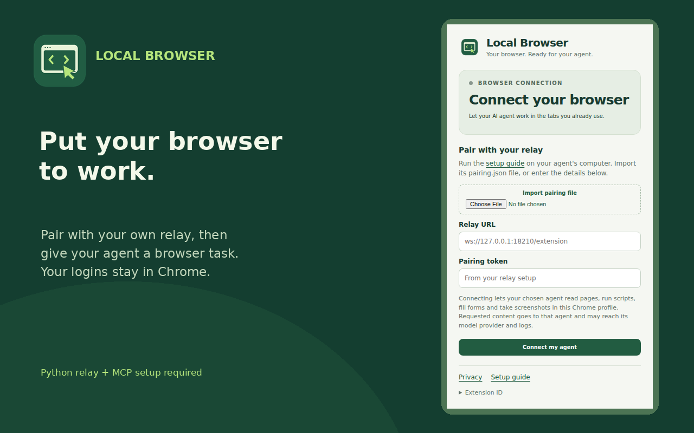

# Local Browser

Let your AI agent work in the Chrome browser you already use, with your existing tabs and signed-in accounts.

Local Browser connects a Chrome extension to an agent through a small relay and an MCP server. The agent can read pages, fill forms, click buttons, run JavaScript, and take screenshots. It uses Chrome extension APIs, with no CDP connection or remote-debugging port.

Built for [Hermes Agent](https://github.com/NousResearch/hermes-agent). Other agents can connect through a standard MCP stdio configuration.



**Install now:** use the [unpacked extension setup](#manual-setup) below. The Chrome Web Store release has been submitted and is pending Google's review. A store install link will appear here once it is published.

You need the small Python relay and MCP connection as well as the Chrome extension. [Privacy policy](docs/privacy.md) · [Setup guide](docs/agent-setup.md)

## Set it up with your agent

Copy this prompt into an agent that has terminal access to the computer where the relay will run:

```text
Set up https://github.com/codejeet/local-browser so you can use my existing
Chrome browser through its MCP tool.

Read the repository README and docs/agent-setup.md first. Check what is already
installed, then use the documented setup script. Establish whether Chrome and
the agent run on the same computer. Use loopback for a same-computer setup;
for separate computers, use private Tailscale Serve with WSS.

Install dependencies in a dedicated Python virtual environment, generate local
credentials without displaying them, load the extension into my intended Chrome
profile, and register the MCP server in my agent's configuration. Preserve my
other MCP entries and any existing browser connection. Guide me through Chrome
steps that require my interaction.

Verify the connection and run the README's smoke test against the included
fixture page: read the DOM, fill and click, check the result with JavaScript,
and capture a screenshot. Leave my other tabs alone. Report the installed paths,
how to start/stop it, and what actually passed.
```

The [agent setup guide](docs/agent-setup.md) has the full procedure. Manual instructions follow.

## What it can do

- List, open, navigate, activate, and close tabs.
- Read visible page text and interactive elements with reusable element references.
- Read HTML, inspect frames, and traverse open shadow roots for DOM actions.
- Fill inputs and selects, click elements, scroll, and dispatch keyboard events.
- Run JavaScript expressions or async function bodies, either in an isolated user-script world or the page's main world.
- Capture the visible area of the selected tab as a PNG.
- Pause or reconnect from the extension popup.

## How the pieces connect

```text
Agent / MCP client
        │ stdio
        ▼
mcp_server.py ── authenticated HTTP on loopback ──► relay.py
                                                     ▲
                                                     │ authenticated WebSocket
                                                     ▼
                                             Chrome extension
                                                     │
                                             Your existing tabs
```

Run the MCP server and relay on the **same host**. Chrome can run there too, or on another computer connected through Tailscale. One relay supports one connected extension at a time.

## Prerequisites

**On the relay / agent host:**

- Python **3.11 or newer**, with `venv` and `pip`.
- Linux, macOS, or WSL for the Python services. The private-file handling uses POSIX APIs.
- Git to clone the project.
- Hermes Agent or another MCP client, if you want agent integration. The command-line client also works on its own.

**On the browser computer:**

- Chrome **135 or newer**. A current stable release is recommended.
- Permission to load an unpacked extension. For custom JavaScript, enable **Allow User Scripts** on Chrome 138+; Chrome 135–137 uses **Developer mode**.
- The Chrome profile you want the agent to use, with Chrome kept running during tasks.

**For separate computers:** Tailscale on both hosts, signed into the same tailnet, with HTTPS certificates enabled for Tailscale Serve. You will need permission to configure Serve on the relay host.

**For development only:** Node.js **18 or newer** and npm, for the JavaScript tests. Node is not needed to run the relay or extension.

## Manual setup

### 1. Clone and install Python dependencies

On the relay / agent host:

```bash
git clone https://github.com/codejeet/local-browser.git
cd local-browser
python3 -m venv .venv
source .venv/bin/activate
python -m pip install -r requirements.txt
```

All following shell examples run from this directory with the virtual environment activated. On Debian/Ubuntu, install your Python version's `venv` package if virtual environment creation reports that it is missing.

### 2. Choose the connection

**Chrome and the relay on the same computer:**

```bash
python setup.py --relay-url ws://127.0.0.1:18210/extension
```

This uses loopback only. If using Windows Chrome with a WSL relay, check that Windows can reach the WSL loopback listener. If localhost forwarding is unavailable, use the separate-computer path below.

**Chrome and the relay on separate computers:**

On the relay host, first inspect existing routes so you can choose an unused HTTPS port:

```bash
tailscale serve status
```

For example, if `9456` is free:

```bash
tailscale serve --bg --https=9456 http://127.0.0.1:18210
```

Use the hostname shown by Serve, replacing `your-relay.your-tailnet.ts.net` below:

```bash
python setup.py --relay-url wss://your-relay.your-tailnet.ts.net:9456/extension
```

Use **Serve**, which is private to your tailnet. Keep the relay bound to loopback. The Chrome computer must be able to reach the Serve URL through Tailscale.

**What setup creates:**

- A private relay configuration at `~/.hermes/local-browser/config.json`, or under `$HERMES_HOME/local-browser/` when that variable is set.
- A private `pairing.json` beside the relay config. Import this file in the extension popup to connect without editing code.
- `extension/connection.js` for compatibility with existing unpacked installs. Store-ID setup skips this legacy file.
- Two independent credentials: one for the extension and one for the operator client. Only the extension credential is copied to the browser computer.

For an unpacked source install, the extension ID is derived from the public key in `extension/manifest.json`. Rerunning setup reuses valid credentials. For a signed Web Store install, use the actual **Extension ID** shown in its popup:

```bash
python setup.py --relay-url ws://127.0.0.1:18210/extension \
  --extension-id YOUR_32_CHARACTER_EXTENSION_ID
```

When deliberately moving an existing relay to a different extension ID, add `--replace-extension-id`, then restart that relay. This preserves credentials while keeping exact origin checks.

To choose another configuration path or local relay port:

```bash
python setup.py --config /absolute/private/path/config.json \
  --port 18211 --relay-url ws://127.0.0.1:18211/extension
```

Pass that same config path to the relay and client, and set `HERMES_LOCAL_BROWSER_CONFIG` for the MCP server. For a remote browser, point Serve at the new local port too.

### 3. Start the relay

```bash
python relay.py
```

Keep this terminal running. The relay listens on `127.0.0.1:18210` by default. For a custom config:

```bash
python relay.py --config /absolute/private/path/config.json
```

For a persistent Linux service, use the [systemd instructions](docs/service.md) after the foreground setup works.

### 4. Load the Chrome extension

If Chrome is on another computer, copy the **`extension/` folder** to a permanent location there. You may omit generated `connection.js` and instead transfer the private `pairing.json` file separately. The relay config and Python virtual environment stay on the relay host.

1. Open `chrome://extensions` in the intended Chrome profile.
2. Turn on **Developer mode**.
3. Click **Load unpacked** and select the `extension/` folder containing `manifest.json`.
4. Open the extension popup. Click **Import pairing file**, choose the private `pairing.json` from setup, then click **Connect my agent**. You can also enter the relay URL and pairing token manually. A valid legacy `connection.js` is imported once automatically.
5. For custom JavaScript, open **Details** and enable **Allow User Scripts** on Chrome 138+. On Chrome 135–137, Developer mode enables the API. Reading pages, filling forms and taking screenshots do not require this toggle.
6. Confirm the popup says **Connected to your agent**.



After changing extension files, click **Reload** at `chrome://extensions`. Connection settings persist in this Chrome profile. To change a relay or token, use **Connection settings** in the popup; a legacy file is not re-imported after pairing. Keep one extension connected to each relay.

### 5. Check the connection

In another terminal, activate the same virtual environment and run:

```bash
python client.py status
python client.py call tabs
```

`status` should report `"connected": true`. `tabs` should return tabs from your intended Chrome profile. A reachable relay with `"connected": false` means the extension has not authenticated and connected yet.

### 6. Add it to your agent

#### Hermes Agent

From the cloned project directory:

```bash
hermes mcp add local-browser \
  --command "$PWD/.venv/bin/python" \
  --args "$PWD/mcp_server.py"
hermes mcp test local-browser
```

If `local-browser` is already registered, inspect its configuration before replacing it. For a custom config path, put `--env` before `--args`:

```bash
hermes mcp add local-browser \
  --command "$PWD/.venv/bin/python" \
  --env HERMES_LOCAL_BROWSER_CONFIG=/absolute/private/path/config.json \
  --args "$PWD/mcp_server.py"
```

Use `/reload-mcp` in Hermes or start a new session to load the tool. See the [Hermes MCP documentation](https://hermes-agent.nousresearch.com/docs/user-guide/features/mcp).

Then ask:

> Use local-browser to inspect my open tabs. Open the relay's fixture page in a new tab and verify that you can fill the form and take a screenshot.

#### Other MCP clients

Add the following entry to your client's MCP configuration, replacing the absolute paths. Merge it with existing entries:

```json
{
  "mcpServers": {
    "local-browser": {
      "command": "/absolute/path/local-browser/.venv/bin/python",
      "args": ["/absolute/path/local-browser/mcp_server.py"],
      "env": {
        "HERMES_LOCAL_BROWSER_CONFIG": "/absolute/private/path/config.json"
      }
    }
  }
}
```

The MCP tool is `local_browser(action, params, timeout=30)`. Your client may add a prefix to its displayed name. Keep the MCP process on the relay host; it calls the relay over loopback.

## Run a smoke test

The relay includes a small test page. Use `http://127.0.0.1:18210/fixture` for a same-computer browser, or `https://your-relay.your-tailnet.ts.net:9456/fixture` for a remote browser.

```bash
python client.py call open --params '{"url":"http://127.0.0.1:18210/fixture"}'
```

Use the returned tab `id` in place of `123` below. Wait for the page to load before taking the snapshot:

```bash
python client.py call snapshot --params '{"tabId":123}'
python client.py call fill --params '{"tabId":123,"selector":"#name","value":"Browser connected"}'
python client.py call click --params '{"tabId":123,"selector":"#apply"}'
python client.py call eval --params '{"tabId":123,"code":"document.querySelector(\"#result\").textContent"}'
python client.py call activate --params '{"tabId":123}'
python client.py call screenshot --params '{"tabId":123}' --output /tmp/local-browser-test.png
python client.py call close --params '{"tabId":123}'
```

The JavaScript result should contain **Browser connected**, and the PNG should show that text on the test page. Close only the test tab. For remote Chrome, change the `open` URL to your Serve URL.

The CLI prints JSON. DOM and JavaScript actions return per-frame results. Through MCP, screenshots are saved to a private cache and returned as an absolute file path; use your agent's image-reading tool to inspect that file.

## Working with the tool

Examples of `action` and `params`:

```json
{"action":"tabs","params":{}}
{"action":"snapshot","params":{"tabId":123,"maxText":18000,"limit":400}}
{"action":"click","params":{"tabId":123,"ref":"e5"}}
{"action":"html","params":{"tabId":123,"selector":"main","maxChars":50000}}
{"action":"frames","params":{"tabId":123}}
{"action":"eval","params":{"tabId":123,"code":"document.title"}}
{"action":"eval","params":{"tabId":123,"body":true,"code":"const title = document.title; return {title};"}}
```

- Start with `tabs` and choose the intended tab. Page actions need an explicit `tabId`.
- A snapshot returns text and element references such as `e5`. Take a fresh snapshot after changing a page; old references may be invalid.
- Use `frameId` to target an iframe or `allFrames: true` to inspect all accessible frames.
- `eval` treats `code` as an expression by default. Use `body: true` for statements with an explicit `return`. Async/await is supported. Set `world: "MAIN"` to access page JavaScript globals.
- Activate a tab before taking its screenshot. Screenshots capture the visible viewport, not a full scrolling page.
- `click`, `fill`, and `key` use DOM events. Native file pickers, browser dialogs, OS shortcuts, and controls requiring trusted input need manual or desktop interaction. A synthetic key event does not type text; use `fill` for text fields.
- Chrome restricts scripting on pages such as `chrome://` and the Chrome Web Store.
- A timeout or disconnect can occur after an action has happened. Inspect the page before repeating a submission or click. Commands are never automatically retried.

## Access and privacy

This extension gives the connected agent access to your signed-in browser. Connect it only to an agent you trust and a Chrome profile you intend to share.

The relay authenticates operator requests and extension connections separately. It accepts the configured extension origin, binds only to loopback, and does not log command bodies or page results. The extension handles requested commands rather than collecting a continuous browsing history. Page content and screenshots returned by a tool become available to the agent and may be retained by the agent's own logs or model provider.

`<all_urls>`, `tabs`, `scripting`, `userScripts`, and `webNavigation` support page access, tab management, JavaScript execution, and frame inspection. `storage` saves the connection and pause settings; `alarms` supports reconnection. There is no `debugger` permission.

Keep `config.json`, `pairing.json` and generated `extension/connection.js` private. The repository ignores generated credentials, caches, and screenshots. The manifest's `key` is a **public key** that keeps the extension ID stable, not an authentication secret.

Use **Pause** in the popup to stop new commands. Disable the extension or stop the relay to disconnect it. Commands already executing may finish. MCP screenshots remain in the private cache until you remove them.

## Troubleshooting

- **Extension is disconnected:** Check that the relay is running and the popup's connection URL matches your topology. Import `pairing.json` or re-enter the pairing details if needed. For remote Chrome, check Tailscale and `tailscale serve status`. Then reload the extension or use **Reconnect**.
- **`Connection refused` or relay unavailable:** Start `relay.py` with the same config and local port used by the client. Confirm the MCP process runs on the relay host.
- **User scripts are unavailable:** Enable **Allow User Scripts** in the extension's Chrome details, update Chrome if needed, and reload the extension.
- **Invalid extension origin:** Use the actual Extension ID from the popup with `setup.py --extension-id`. If deliberately replacing an existing identity, add `--replace-extension-id` and restart the relay; keep origin validation enabled.
- **Another extension is already connected:** Pause or disable the duplicate copy in the other profile or computer. Each relay accepts one connection.
- **Stale element ref:** Take a new snapshot and use its references. A selector must match exactly one element.
- **Screenshot needs an active tab:** Call `activate`, then `screenshot`. A tab switch during capture causes the image to be discarded.
- **MCP tool is missing:** Run `hermes mcp test local-browser`; check the absolute interpreter and script paths, then use `/reload-mcp` or a new session.
- **Python dependency is missing:** Use the project's `.venv/bin/python`, not a different system interpreter.

## Development

```bash
source .venv/bin/activate
python -m pip install -r requirements-dev.txt
npm ci
python -m unittest discover -s tests -v
node --test tests/*.test.cjs
```

The automated tests cover the relay protocol, authentication, disconnects and timeouts, MCP discovery, client output, setup, and extension DOM behavior. Use the smoke test above to verify an actual Chrome installation.

Project layout:

```text
extension/       Chrome Manifest V3 extension
relay.py         Authenticated HTTP / WebSocket relay
client.py        CLI and async Python client
mcp_server.py    MCP stdio tool
setup.py         Local credential and connection setup
requirements.txt Runtime Python dependencies
tests/           Python integration and JavaScript tests
docs/            Agent setup and persistent-service guides
```
